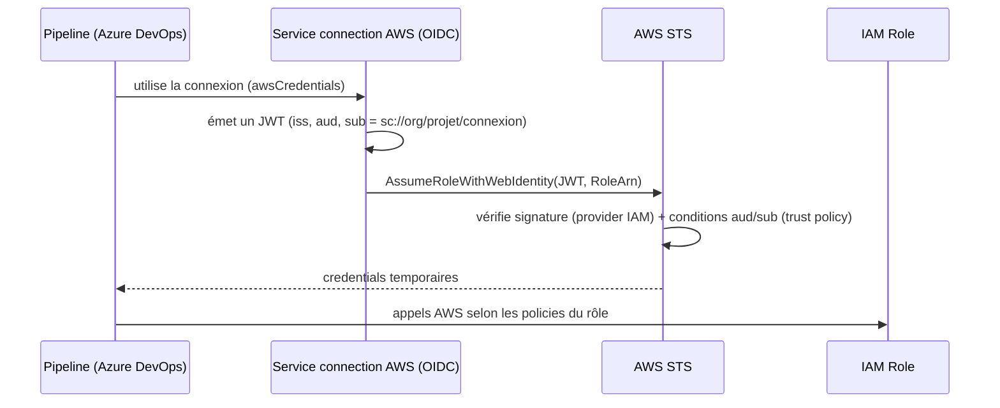

# azdo-aws-oidc

Authentifier des pipelines **Azure DevOps** auprès d'**AWS** via **OIDC** (workload identity federation), sans clé d'accès longue durée.

- Deux modules Terraform composables : `oidc-provider` (1 par compte) et `oidc-role` (1 par service connection / environnement).
- Un exemple de stack par compte, des tests natifs (`terraform test`, sans accès AWS) et un pipeline consommateur.
- Documentation : [architecture (schémas)](docs/architecture.md), [design](docs/design.md), [configuration Azure DevOps](docs/azure-devops-setup.md), [dépannage](docs/troubleshooting.md).

## Principe



## Utilisation rapide

```bash
cd examples/account
cp terraform.tfvars.example terraform.tfvars   # adapter issuer_url, org/projet/connexions
terraform init -backend-config=...             # un state par compte AWS
terraform apply
terraform output role_arns                      # -> à saisir dans la service connection
```

Puis créer la service connection dans Azure DevOps : [docs/azure-devops-setup.md](docs/azure-devops-setup.md).

## Modules

| Module | Rôle | Entrées clés | Sorties |
|---|---|---|---|
| `modules/oidc-provider` | `aws_iam_openid_connect_provider` pour l'issuer Azure DevOps | `issuer_url`, `client_id_list` | `arn`, `host` |
| `modules/oidc-role` | Rôle IAM + trust policy `aud`/`sub` + policies | `provider_arn`, `provider_host`, `service_connections`, `managed_policy_arns`, `inline_policies` | `role_arn`, `role_name`, `subjects` |

## Tests

```bash
for m in modules/oidc-provider modules/oidc-role; do (cd $m && terraform init -backend=false && terraform test); done
cd examples/account && terraform init -backend=false && terraform validate
```

## Avertissement : issuer en cours de dépréciation

Microsoft annonce le retrait de l'issuer `https://vstoken.dev.azure.com/<guid>` au **1er juillet 2027** pour les service connections *Azure Resource Manager* ; les nouvelles utilisent l'issuer Microsoft Entra. L'impact exact sur les service connections *AWS* n'est pas confirmé par la documentation consultée : voir [design.md §Risques](docs/design.md#risques-et-points-ouverts). Les modules sont indépendants de l'issuer (`issuer_url` + `subjects`) pour absorber ce changement.
