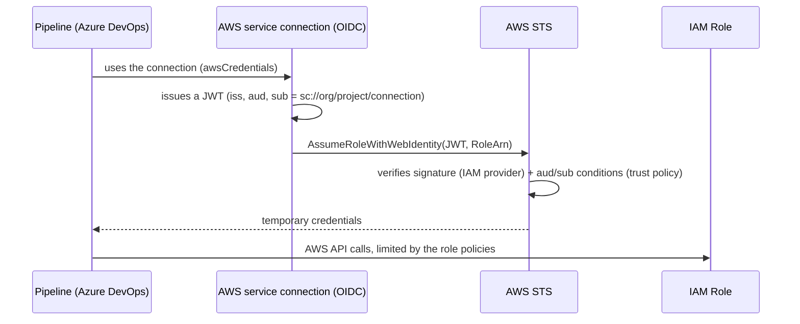

# azdo-aws-oidc


Authenticate **Azure DevOps** pipelines to **AWS** with **OIDC** (workload identity federation), with no long-lived access keys.

- Two composable Terraform modules: `oidc-provider` (one per account) and `oidc-role` (one per service connection / environment).
- A per-account example stack, native tests (`terraform test`, no AWS access needed) and a consumer pipeline.
- Documentation: [architecture (diagrams)](docs/architecture.md), [design](docs/design.md), [Azure DevOps setup](docs/azure-devops-setup.md), [troubleshooting](docs/troubleshooting.md).

## How it works



## Quick start

```bash
cd examples/account
cp terraform.tfvars.example terraform.tfvars   # set issuer_url, org/project/connections
terraform init -backend-config=...             # one state per AWS account
terraform apply
terraform output role_arns                      # -> value for the service connection
```

Then create the service connection in Azure DevOps: [docs/azure-devops-setup.md](docs/azure-devops-setup.md).

## Modules

| Module | Purpose | Key inputs | Outputs |
|---|---|---|---|
| `modules/oidc-provider` | `aws_iam_openid_connect_provider` for the Azure DevOps issuer | `issuer_url`, `client_id_list` | `arn`, `host` |
| `modules/oidc-role` | IAM role + `aud`/`sub` trust policy + policies | `provider_arn`, `provider_host`, `service_connections`, `managed_policy_arns`, `inline_policies` | `role_arn`, `role_name`, `subjects` |

## Tests

```bash
for m in modules/oidc-provider modules/oidc-role; do (cd $m && terraform init -backend=false && terraform test); done
cd examples/account && terraform init -backend=false && terraform validate
```

## Warning: issuer being retired

The `https://vstoken.dev.azure.com/<guid>` issuer used by this setup (as in the [official AWS walkthrough](https://aws.amazon.com/blogs/modernizing-with-aws/how-to-federate-into-aws-from-azure-devops-using-openid-connect/)) is deprecated by Microsoft for Azure connections, with end of life on **July 1, 2027**, in favour of the Microsoft Entra issuer. Whether AWS service connections will follow, and whether AWS STS will then accept the token, is **not confirmed** (see [design.md, Risks](docs/design.md#risks-and-open-points) and [aws-toolkit-azure-devops#614](https://github.com/aws/aws-toolkit-azure-devops/issues/614)). The modules are issuer-agnostic (`issuer_url` + `subjects`) to limit the impact.

## Diagram

The picture above is generated by [`docs/images/architecture.py`](docs/images/architecture.py) (Python [`diagrams`](https://diagrams.mingrammer.com/) + Graphviz): `python3 docs/images/architecture.py` from the repository root. More views (runtime, multi-account topology, trust evaluation) are in [docs/architecture.md](docs/architecture.md).

AWS, Azure DevOps and Terraform names and logos are trademarks of their respective owners and are used only to identify the products in the diagram.
