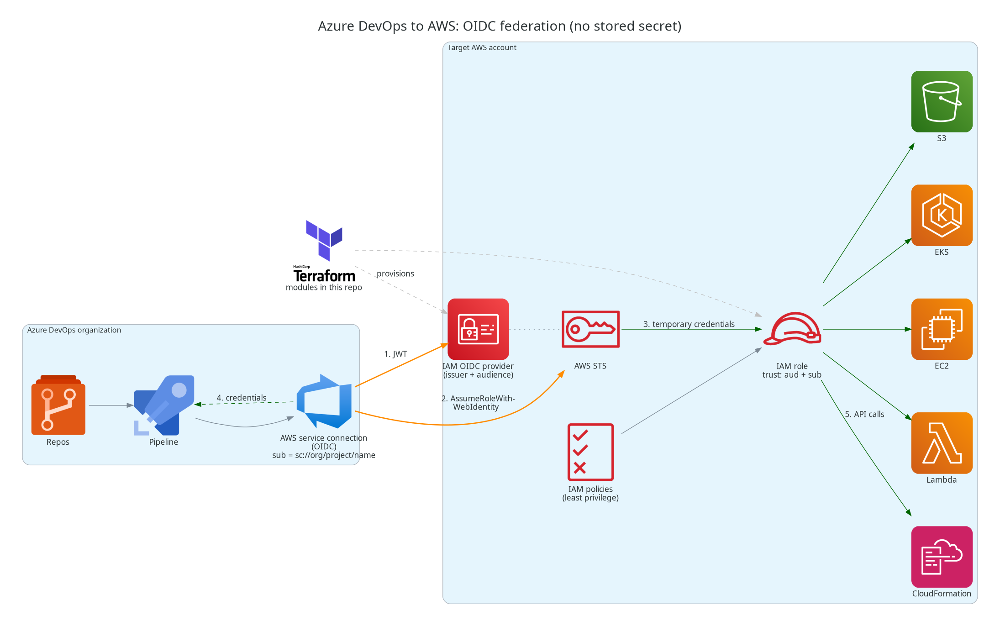
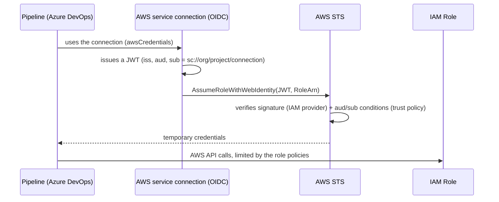

# azdo-aws-oidc



Let **Azure DevOps** pipelines deploy to **AWS** without any stored AWS secret, using **OIDC federation**: the pipeline proves its identity with a short-lived signed token, and AWS hands back temporary credentials limited to one IAM role.

This repository contains the Terraform modules that create the AWS side of that trust, a ready-to-adapt example, tests, and the documentation (design, diagrams, Azure DevOps setup, troubleshooting).

## The problem

The usual way to let an Azure DevOps pipeline reach AWS is an **IAM user with an access key** stored in a service connection. That brings well-known problems:

- the key is **long-lived**: if it leaks (logs, exports, a departing admin), it stays valid until someone notices and rotates it;
- **rotation is manual** and easy to postpone, and every rotation touches Azure DevOps and AWS;
- keys tend to be **shared** across projects and environments, so one leak exposes dev and prod;
- the permissions of the IAM user are often **broader than any single pipeline needs**;
- it is hard to answer "which pipeline used this key?" in AWS audit logs.

## The solution

With OIDC federation there is nothing to steal or rotate:

| | Access key in a service connection | OIDC federation (this repo) |
|---|---|---|
| Secret stored in Azure DevOps | Yes (access key + secret) | **None** |
| Credential lifetime | Until rotated | **Minutes to hours** (`max_session_duration`) |
| Rotation | Manual | **Not needed** |
| Scope | Whatever the IAM user can do | **One role per service connection / environment** |
| Who can obtain credentials | Anyone holding the key | Only the **named service connection** (`sub` claim) |
| AWS audit trail | One shared IAM user | A role session per assumption |

## Who it is for and typical use cases

For platform, cloud and DevOps engineers who run Azure DevOps pipelines against one or several AWS accounts.

- **Infrastructure as code**: Terraform, CloudFormation or CDK pipelines applying changes to AWS accounts.
- **Application delivery**: pipelines pushing to S3, deploying Lambda functions, updating ECS/EKS workloads, running CodeDeploy.
- **Multi-account setups**: one provider per account and one role per environment (dev / test / prod), each tied to its own service connection.
- **Migration off access keys**: replace existing IAM-user keys with roles, then delete the keys (see [Migrating from access keys](#migrating-from-access-keys)).

## What this repository provides, and what it does not

Provides:

- `modules/oidc-provider`: the IAM OIDC identity provider for the Azure DevOps issuer (one per account).
- `modules/oidc-role`: an IAM role whose trust policy only accepts a given audience and given service connections, plus its permissions.
- `examples/account`: a stack to run once per AWS account; `pipelines/`: how a pipeline consumes the connection.
- Native `terraform test` tests (no AWS access needed) and documentation.

Does not (by design):

- create the **service connection** in Azure DevOps (done in the UI/API, see [setup guide](docs/azure-devops-setup.md));
- bootstrap the credentials needed to run Terraform in each account (deployment role, SSO...);
- cover the opposite direction (AWS workloads calling Azure) or Azure Resource Manager connections;
- decide your permissions: you choose the policies attached to each role (least privilege is recommended, not forced).

If your agents already run on EC2 with an instance profile, you may not need federation at all: the toolkit can use the instance credentials.

## Prerequisites

- An Azure DevOps organization and project where you can create service connections.
- **AWS Toolkit for Azure DevOps 1.15.0 or later** installed in the organization.
- Terraform >= 1.5 and AWS provider >= 5.81, and permission to create IAM providers and roles in the target accounts.

## How it works



1. **Terraform (once per account)** registers the Azure DevOps issuer as an IAM OIDC provider and creates one role per environment. The role trusts the provider only when the token audience is `api://AzureADTokenExchange` and the subject is exactly the expected service connection.
2. **Azure DevOps** holds a service connection of type *AWS* with "Use OIDC" and the role ARN. No key is entered.
3. **At run time**, the task asks Azure DevOps for a token, exchanges it with AWS STS for temporary credentials, and runs with the role's permissions only.

More detail: [architecture diagrams](docs/architecture.md) and [design and decisions](docs/design.md).

## Quick start

```bash
cd examples/account
cp terraform.tfvars.example terraform.tfvars   # set issuer_url, org/project/connections
terraform init -backend-config=...             # one state per AWS account
terraform apply
terraform output role_arns                      # -> value for the service connection
```

The complete order of operations (create the connection, read the issuer and subject from the first run, apply Terraform, verify) is in the [Azure DevOps setup guide](docs/azure-devops-setup.md).

## Migrating from access keys

1. Create the provider and a role per environment with this repository, with permissions equivalent to what the IAM user had (then tighten them).
2. Edit the existing service connection (or create a new one): tick **Use OIDC**, enter the role ARN, remove the access key and secret. Tasks keep the same `awsCredentials` input, so pipelines usually do not change.
3. Run the pipelines and check `aws sts get-caller-identity` returns the assumed role.
4. Disable then delete the old IAM user and its access keys.

## Security model in one paragraph

AWS trusts a token only if it comes from the registered issuer, carries the expected audience and has an exact `sub` (`sc://<org>/<project>/<connection>`). The `sub` identifies the service connection, not the pipeline or the branch, so the boundary between pipelines is enforced in Azure DevOps (pipeline authorization, approvals, protected branches). Hence the rule: **one connection and one role per environment**, never a connection shared between prod and non-prod. Details in [design.md](docs/design.md).

## Glossary

| Term | Meaning here |
|---|---|
| OIDC | OpenID Connect: a standard to prove an identity with a signed token (JWT). |
| Issuer (`iss`) | Who signs the token; AWS is told to trust it via the IAM OIDC provider. |
| Audience (`aud`) | Who the token is meant for; fixed to `api://AzureADTokenExchange` for Azure DevOps. |
| Subject (`sub`) | Which workload the token represents; here the service connection. |
| Service connection | Azure DevOps object that stores how a pipeline authenticates to an external service. |
| STS | AWS Security Token Service, which exchanges the token for temporary credentials. |
| Trust policy | The IAM role policy stating who may assume the role (conditions on `aud` and `sub`). |

## Modules

| Module | Purpose | Key inputs | Outputs |
|---|---|---|---|
| `modules/oidc-provider` | `aws_iam_openid_connect_provider` for the Azure DevOps issuer | `issuer_url`, `client_id_list` | `arn`, `host` |
| `modules/oidc-role` | IAM role + `aud`/`sub` trust policy + policies | `provider_arn`, `provider_host`, `service_connections`, `managed_policy_arns`, `inline_policies` | `role_arn`, `role_name`, `subjects` |

## Tests

```bash
for m in modules/oidc-provider modules/oidc-role; do (cd $m && terraform init -backend=false && terraform test); done
cd examples/account && terraform init -backend=false && terraform validate
```

## Warning: issuer being retired

The `https://vstoken.dev.azure.com/<guid>` issuer used by this setup (as in the [official AWS walkthrough](https://aws.amazon.com/blogs/modernizing-with-aws/how-to-federate-into-aws-from-azure-devops-using-openid-connect/)) is deprecated by Microsoft for Azure connections, with end of life on **July 1, 2027**, in favour of the Microsoft Entra issuer. Whether AWS service connections will follow, and whether AWS STS will then accept the token, is **not confirmed** (see [design.md, Risks](docs/design.md#risks-and-open-points) and [aws-toolkit-azure-devops#614](https://github.com/aws/aws-toolkit-azure-devops/issues/614)). The modules are issuer-agnostic (`issuer_url` + `subjects`) to limit the impact.

## Diagram

The picture above is generated by [`docs/images/architecture.py`](docs/images/architecture.py) (Python [`diagrams`](https://diagrams.mingrammer.com/) + Graphviz): `python3 docs/images/architecture.py` from the repository root. More views (runtime, multi-account topology, trust evaluation) are in [docs/architecture.md](docs/architecture.md).

AWS, Azure DevOps and Terraform names and logos are trademarks of their respective owners and are used only to identify the products in the diagram.

## License

Licensed under the [Apache License 2.0](LICENSE). Copyright 2026 Jocelyn Fontaine.
