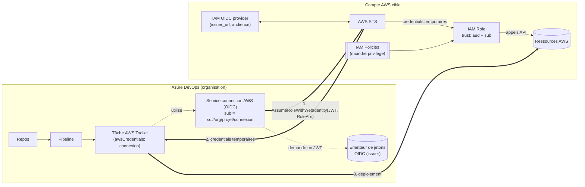
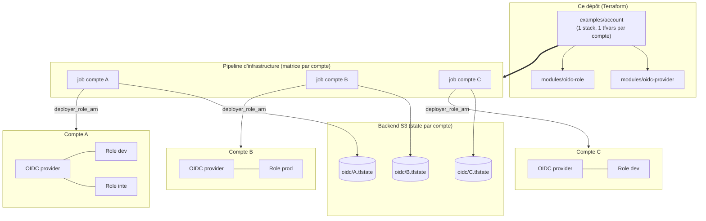
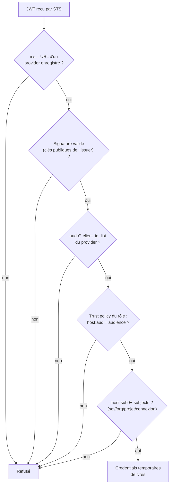

# Architecture

Trois vues : le flux d'exécution, la topologie de déploiement multi-comptes, et l'évaluation de la confiance côté AWS.

## 1. Flux d'exécution (runtime)

Points clés : aucun secret stocké dans Azure DevOps ; les credentials expirent (durée = `max_session_duration`) ; AWS ne fait confiance qu'à l'issuer enregistré dans le provider.

## 2. Topologie de déploiement (multi-comptes)

Un provider par compte, un rôle par environnement. Le state et les credentials de déploiement sont isolés par compte.

## 3. Évaluation de la confiance (trust policy)

Le `sub` est la seule frontière entre deux connexions d'une même organisation : d'où la règle « une connexion + un rôle par environnement » et le garde-fou refusant un rôle sans `sub` ou avec `*` seul (voir [design.md](design.md)).

## 4. Responsabilités

| Couche | Responsable de | Outil |
|---|---|---|
| Azure DevOps | Qui peut utiliser la connexion (pipelines autorisés, approvals, branches) | Service connection + checks |
| Trust policy | Quelle connexion peut assumer quel rôle | `modules/oidc-role` (`aud`, `sub`) |
| Policies du rôle | Ce que la connexion peut faire dans le compte | `managed_policy_arns`, `inline_policies` |
| Provider IAM | Quel émetteur est reconnu | `modules/oidc-provider` |
