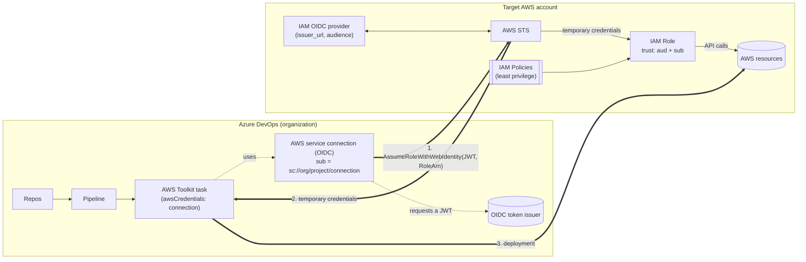
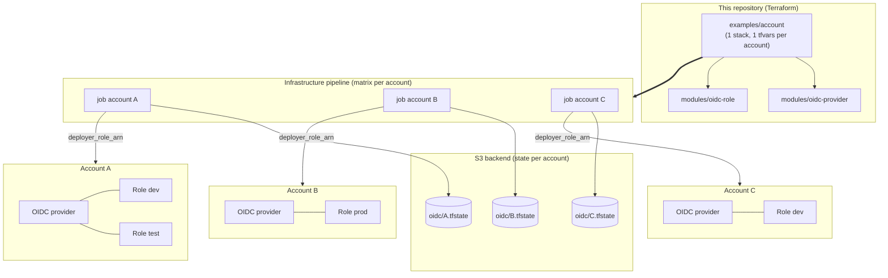
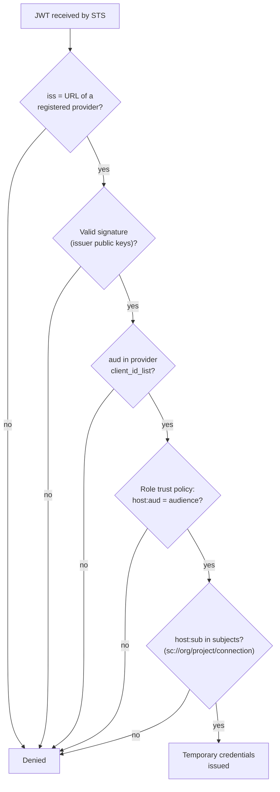

# Architecture

Three views: the runtime flow, the multi-account deployment topology, and how AWS evaluates trust.

## 1. Runtime flow

Key points: no secret stored in Azure DevOps; credentials expire (duration = `max_session_duration`); AWS only trusts the issuer registered in the provider.

## 2. Deployment topology (multi-account)

One provider per account, one role per environment. State and deployment credentials are isolated per account.

## 3. Trust evaluation

`sub` is the only boundary between two connections of the same organization, hence the rule "one connection + one role per environment" and the guard rail rejecting a role without `sub` or with a bare `*` (see [design.md](design.md)).

## 4. Responsibilities

| Layer | Responsible for | Tool |
|---|---|---|
| Azure DevOps | Who can use the connection (authorized pipelines, approvals, branches) | Service connection + checks |
| Trust policy | Which connection can assume which role | `modules/oidc-role` (`aud`, `sub`) |
| Role policies | What the connection can do in the account | `managed_policy_arns`, `inline_policies` |
| IAM provider | Which issuer is recognized | `modules/oidc-provider` |
